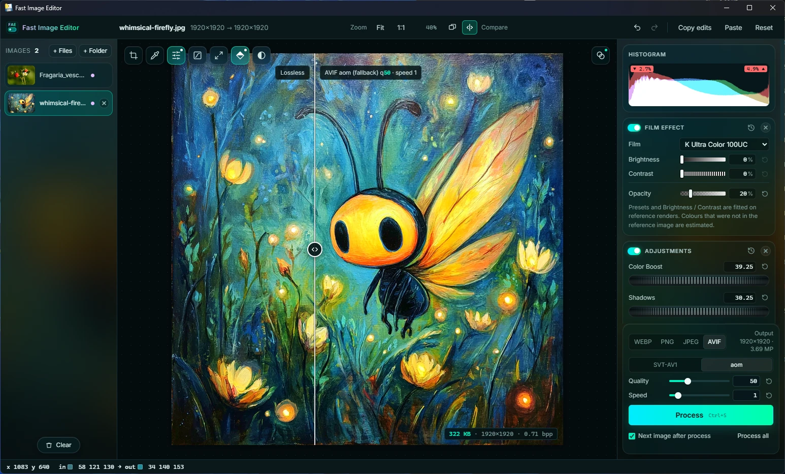

# Fae

**Fast Image Editor.** A fast, keyboard-friendly desktop editor for batch-preparing images: crop and rotate, colour-correct with eyedroppers and curves, resize to 720p or a target megapixel count, then export to lossless WEBP/PNG or lossy JPEG (jpegli), AVIF (SVT-AV1) or WEBP. Lossy formats have a split-view preview, so you can judge the real encode at the chosen settings before saving.

Built with Python + [pywebview](https://pywebview.flowrl.com/). The UI is HTML/JS; the edit math is a Rust core (Python extension + WebAssembly, see below); loading, geometry, resizing and encoding use NumPy, OpenCV and Pillow.

## Preview



## Features

**Workflow**
- Drag and drop images or whole folders, or use **+ Files** / **+ Folder**
- Every image keeps its own edits and undo history
- Copy / paste edits between images
- **Process** the current image, or **Process all**, where each image uses its own edits
- Optionally jump to the next image after processing
- Nothing is written until you press Process. Output goes next to the source as `name_WxH.ext` and never overwrites existing files

**Geometry**
- Crop & rotate mode with 90° steps, fine angle ruler, horizontal flip and aspect presets (Free, Original, 1:1, 16:9, 9:16, 4:3, 3:2, …)
- Bound-aware crop: the crop box can never leave the rotated image
- Wheel zooms the crop toward the cursor; `Alt`/`Ctrl` + wheel rotates (fine angle)
- **Straighten** (`S` or the ruler button): draw a line along a horizon, wall or edge; the image turns so the line becomes exactly level or upright, whichever is nearer
- The view follows the crop: as the box gets smaller the camera zooms in and pans to keep its edges near the screen edges

**Colour**
- Black / neutral-gray / white point eyedroppers that stay active, so you can keep clicking to refine
- Hold **Alt** for a clipping / threshold view (shadows, highlights or neutral candidates); scroll to move the threshold
- Master + R/G/B curves (monotone cubic) with live input histogram
- Output histogram with clipping percentages
- Automatic colour balance: Percentile White-Patch and Gray-Edge, each with a strength control
- **Adjustments** modelled on DaVinci Resolve's Primaries: Color Boost, Shadows, Highlights, Saturation, Temp, Tint, Contrast + Pivot and Mid/Detail, matched to Resolve's output within about half a level (0–255) on reference grades
- **Filters** (the Filters button at the end of the tool buttons opens a searchable grid of filter tiles; a click adds the filter to the end of the chain, or drag a tile into the panel to put it where the drop line shows; a tile shows how many are in the chain and where, e.g. `×2 · #2, #4 in chain`): Perceptual Saturation filter with Saturation and Warmth matched to the reference filter within 1 level (0–255), Perceptual Saturation (marked ≈) as an **approximation** that pushes colours away from their surroundings but does not match the reference exactly, and Opacity to blend the result. Film Effect: film presets (colour tables fitted on reference renders; the Film field opens a list of the films on your image, hover previews, click picks) plus Brightness and Contrast. Super Contrast: Correct Color Cast and Correct Contrast matched to the reference within 1 level, Dynamic Contrast (marked ≈) as an approximation (local, contrast-limited equalization), and Opacity.
- Jog-wheel controls: drag the wheel left/right (`Shift` fine, `Ctrl` coarse), double-click to reset. Every number box can also be dragged left/right
- Tool pills in the viewport show or hide each tool's card
- **Stack tools**: Adjustments, Curves and the filters can be in the chain more than once (up to 8 each), each copy with its own values, switch, place and optional label — Duplicate icon in the island's head or `Ctrl+D`, a Filters tile adds another copy of an open filter (or drag it into the panel), right-click an island's head for Duplicate / Rename / Move up / Move down / Reset / Remove (`F2`, `Del`). Copies show `[1]`, `[2]` in chain order. Mid/Detail is on the first Adjustments only
- **Presets** on Adjustments, Curves, Perceptual Saturation, Super Contrast and Sharpen: the button in the tool's row shows the current preset (`Default`, a name, or `Custom`) and opens a list with thumbnails of the current image through each preset; hover previews it on the image, click applies it (one undo step); save the current values as a preset, rename or delete your own
- **Edit presets** (Presets in the top bar): the whole edit in one preset — Resize, Color balance, Adjustments, Curves, the filters and Sharpen with their order and on / off state. Cards with a thumbnail of the current image through the preset and the tools it uses; hover previews (Resize and Color balance take effect on click), click applies (one undo step), ⋯ renames, updates with the current edits or deletes. Crop, point correction and the output format stay with the image

**Resize**
- **Preset**: aspect ratio (16:9, 21:9, 4:3, 3:2, 1:1, 4:5, 9:16) × resolution (2160p, 1440p, 1080p, 720p, 480p, 360p; the p-number is the short side), cover-crop
- **Target Mpix** with *Mpix priority*, *Balanced* or *Ratio error priority*
- **Custom**: type in width × height, then *Crop in* (cover-crop) or *Stretch*
- Warns when the resize would upscale

**Input formats**

JPEG, PNG, WEBP, AVIF, BMP, GIF, TIFF, TGA, PPM/PGM, ICO, plus **HEIC/HEIF** and **JPEG XL** (load only).

**Output formats**

| Format | Encoder | Settings |
|---|---|---|
| WEBP | libwebp (Pillow), `method=6` | Lossless, or Lossy + quality |
| PNG | Pillow, `compress_level=9` | — |
| JPEG | **jpegli** (`encoders/cjpegli.exe`), Pillow fallback | Quality *or* Butteraugli distance |
| AVIF | **SVT-AV1** (`encoders/SvtAv1EncApp.exe`), 10-bit 4:4:4, `--tune 3`; Pillow/aom fallback | CRF (0.25 steps), preset 0–8 |

- ICC profiles from the source are carried over
- **Split-view compare** for lossy formats: drag the divider. Left is the lossless edit, right is the actual encode decoded back
- The encoded file size and bits per pixel are shown at the image's bottom-right corner

Pipeline order: `geometry → resize → White-Patch → Gray-Edge → point correction → curves → encode`

## Requirements

- Windows 10/11 (the bundled encoders are Windows builds; the Python code itself is portable)
- Python 3.10+
- Python packages:

```
pip install -r requirements.txt
```

(`pywebview>=5.0`, `pillow>=11.2`, `numpy`, `opencv-python`, `pillow-heif`, `pillow-jxl-plugin`). Pillow 11.2 or newer is needed for AVIF decoding in the preview and for the aom fallback.
The Rust core is required as well: build it once with `core\build_core.bat` (see [Rust core](#rust-core)).

`pillow-heif` (HEIC/HEIF) and `pillow-jxl-plugin` (JPEG XL) are optional and only needed to **open** those formats. Without them, the app still runs, and opening such a file shows which package to install.

### Encoders

The encoder binaries are **not in the repository**. They come with the [release](../../releases) zip. Put them in the `encoders/` folder:

```
encoders/
├── cjpegli.exe        # jpegli, from libjxl
└── SvtAv1EncApp.exe   # SVT-AV1 (SVT-AV1-HDR fork)
```

Both are optional:
- Without `cjpegli.exe`, JPEG uses Pillow's libjpeg-turbo, which has no distance mode.
- Without `SvtAv1EncApp.exe`, AVIF uses Pillow's libavif/aom.

The app shows which encoder is in use.

## Running

```
run.bat [images or folders...]
```

or

```
python fae.py [images or folders...]
python fae.py --debug     # opens the web inspector
python fae.py --selftest  # checks for the Rust core (WASM, threads, Python extension)
python fae.py --native-frame  # normal Windows title bar instead of the app's own header
```

## Rust core

All edit math runs in one Rust crate (`core/`), built twice: as the Python extension `fastedit_core`
(Process, lossy compare preview) and as WebAssembly (`ui/wasm/`, the live preview, multithreaded in
its own worker: `ui/js/preview-worker.js`). The UI only computes the tables the sliders stand for
(`ui/js/edit-math.js`); there is no NumPy or JS fallback, so the core has to be built:

```
core\build_core.bat        # needs Rust from https://rustup.rs (MSVC build tools)
```

`build.bat` runs it too. The Rust version is pinned in `core/rust-toolchain.toml` (the threaded
WebAssembly build rebuilds Rust's standard library; the script adds the `rust-src` component itself).
Without the extension the app shows how to build it; without `ui/wasm/` the preview shows the
unedited image and says so. `FASTEDIT_COI=0` turns off the cross-origin isolation headers the
threaded WebAssembly needs.

### Tests

Both builds must give exactly the stored pixels and histograms (needs node). Run from the project
folder:

```
python tests/parity/parity.py check --impl core   # Python extension
python tests/parity/parity.py check --impl wasm   # WebAssembly (single-threaded in node)
python tests/parity/parity.py record              # only after a deliberate change of the math
python tests/bench/bench_python.py                # full-resolution timings
python fae.py --selftest            # WebView2 checks + live-preview timings
```

Cases are random slider values run through the UI's own `computeEdit` / `jobFor`, stored in
`tests/parity/cases.json.gz` by `record` so every machine checks the same inputs (`parity.py tables`
shows whether this machine's JS computes the tables differently). The test images are synthetic.
Own images can go into `tests/parity/images/` (not committed).

## Keyboard shortcuts

| Key | Action |
|---|---|
| `Ctrl+S` / `Enter` | Process current image |
| `Ctrl+O` | Add files |
| `↑` / `↓`, `PgUp` / `PgDn` | Previous / next image |
| `Ctrl+Z`, `Ctrl+Y` / `Ctrl+Shift+Z` | Undo / redo |
| `Ctrl+Shift+C` / `Ctrl+Shift+V` | Copy / paste edits |
| `B` / `G` / `W` | Black / gray / white eyedropper |
| `Esc` | Drop the eyedropper |
| `Alt` (hold) | Clipping / threshold view; scroll adjusts the threshold (Shift = ×5) |
| `\` (hold) | Before view (point correction and curves off) |
| `C` | Crop & rotate mode |
| `0` / `1` | Fit / actual pixels |
| `+` / `-`, mouse wheel | Zoom |
| `Space` + drag, middle drag | Pan |
| Double-click image | Toggle fit / 1:1 |

**Crop mode**

| Key | Action |
|---|---|
| `Enter` / `C` | Apply |
| `Esc` | Cancel |
| `[` / `]` | Rotate 90° left / right |
| `,` / `.` | Fine angle ±0.1° (Shift = ±1°) |
| `H` | Flip horizontal |
| `S` | Straighten: draw a line along something that should be level or upright (Shift while drawing = steadier aim, Esc = cancel) |
| `R` | Reset |
| Mouse wheel | Zoom the crop in / out toward the cursor (Shift = finer) |
| `Alt` / `Ctrl` + wheel | Fine angle ±0.1° (Shift = ±1°) |
| Arrow keys | Nudge crop (Shift = 10 px) |

**Curves and sliders:** click to add a point, drag to move it, double-click it or drag it out of the box to remove it. Double-click a slider to reset it. Scroll over a number box to step its value (Shift = ×10).

## Notes on encoding

- **JPEG (jpegli)**: the image is handed to `cjpegli` as a PNG with its ICC profile. Transparent images are flattened onto white.
- **AVIF (SVT-AV1)**: RGB is converted to 10-bit full-range BT.709 YUV 4:4:4 and encoded as a still picture with `--avif 1 --tune 3`. The AV1 bitstream is then wrapped into an `.avif` container by the app itself, so no `avifenc` is needed. The file is tagged as sRGB / full range, plus ICC if present. Images with alpha use the aom fallback.
- **WEBP lossless** uses `quality=100, method=6, exact=True` (maximum effort).

## Project layout

```
fae.py   # entry point
fastedit/              # Python back end
├── config.py          # paths, defaults, per-image stage parameters
├── geometry.py        # resize presets, crop / rotate / flip
├── colour.py          # White-Patch, Gray-Edge
├── core.py            # the Rust core (fastedit_core): Process / compare preview
├── engine.py          # image loading, stage cache, thumbnails
├── proc.py            # running external encoders (cancellable preview encodes)
├── jpeg.py, avif.py   # JPEG (jpegli) and AVIF (SVT-AV1 + container muxer, aom fallback)
├── output.py          # WEBP, lossy dispatch, saving
├── api.py             # JS API used by the UI
└── app.py             # local HTTP server, window, drag and drop
ui/
├── index.html
├── style.css
└── js/                # state, film-tables, film/*, edit-math, render, compare, stage, view, sharp-view,
    │                  # curves, controls, files, tools, presets, instances, chain-presets, process, init, crop (loaded in that order)
    └── film/          # one file per Film Effect preset (33×33×33 colour table)
core/                  # Rust core: fastedit-core (math), fastedit-py (Python), fastedit-wasm
tests/parity/          # bit-exactness tests of both core builds against stored goldens
tests/bench/           # timings
encoders/              # cjpegli.exe, SvtAv1EncApp.exe (from the release)
run.bat
requirements.txt
```

Settings are saved to `fae_settings.json` next to the script, your presets to `fae_presets.json`.

## Trademarks

Film stock names used for the Film Effect presets are trademarks of their respective owners. The presets are approximations made for this project and are not affiliated with or endorsed by them.
